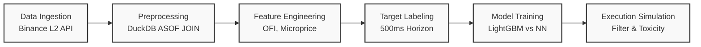

# 📊 Detecting Order Flow Toxicity in Cryptocurrency Perpetual Futures

[](https://www.python.org/)
[](https://lightgbm.readthedocs.io/)
[](https://duckdb.org/)
[](#citation)

## 📌 Overview

This repository contains the full end-to-end research pipeline for detecting **Order Flow Toxicity** in cryptocurrency markets. Toxicity (or adverse selection) occurs when market makers trade against informed counterparties, leading to consistent losses.

Using **1.6 million aggregated trades** and L2 order book updates for BTCUSDT Perpetual Futures (Binance), we train a machine learning detector to predict whether a trade will be toxic within a **500ms horizon**.

This work is the subject of an independent research paper, currently **under review at SSRN** (Quantitative Finance / Market Microstructure).

## 🏆 Key Results

*   **Baseline Detector (LightGBM):** Achieves an **AUC-ROC of 0.6606** and a **Deflated AUC (DSR) of 1.0000**, proving statistical significance.
*   **Economic Impact:** Filtering out trades with a toxicity probability > 0.6 removes 12.9% of trades and reduces the overall toxicity rate from **13.08% to 10.48%** (a relative reduction of 20%).
*   **Advanced Models Comparison:** We compared LightGBM against three deep learning architectures:
    *   *LTN (Neuro-Symbolic):* AUC 0.5749
    *   *PINN (Physics-Informed):* AUC 0.5995
    *   *PULSE (Online Bayesian):* AUC 0.6215
    *   *Conclusion:* Tree-based models remain superior for noisy, tabular HFT data.

## 🏗️ Pipeline Architecture


1. Data Ingestion: Fetch raw L2 bookTicker and aggTrades from Binance Vision.
2. Preprocessing: Synchronize streams using DuckDB ASOF JOIN (prevents look-ahead bias).
3. Feature Engineering: Compute Microstructure features (OFI, Microprice Deviation, Queue Imbalance, VPIN Proxy).
4. Target Labeling: Define toxicity based on price movement against the aggressor within 500ms.
5. Model Training: Train LightGBM and Neural Networks on an 80/20 time-based split.
6. Execution Simulation: Simulate a market-making filter to quantify economic value.

```txt
crypto-order-flow-toxicity/
├── data/
│   ├── raw/                  # Downloaded L2 and trade data (Parquet) - ignored by git
│   └── processed/            # Feature-engineered dataset - ignored by git
├── src/
│   ├── data_loader.py        # Script to download Binance data
│   ├── toxicity_features.py  # Toxicity features calculation (OBI, OFI, etc.)
│   ├── detector.py           # LightGBM training & evaluation (CPCV, DSR)
│   ├── advanced_detectors.py # LTN, PINN, and PULSE implementations
│   └── evaluation.py         # Generates plots for the paper
├── results/plots/            # Saved figures (ROC, distributions, etc.)
├── requirements.txt
├── SCIENTIFIC_PAPERS.md      # Theoretical foundation & literature review
└── README.md
```

How to Run
Clone the repository:

```bash
git clone https://github.com/ArkadySkv/crypto-order-flow-toxicity.git
cd crypto-order-flow-toxicity
```

Install dependencies:

```bash
pip install -r requirements.txt
```

Download Data:
(Note: The raw data files are large and not included in this repo. You must run this script to download them.)

```bash
python3 src/data_loader.py
```

Build Features:

```bash
python3 src/toxicity_features.py
```

Train and Evaluate Models:

```bash
python3 src/detector.py
python3 src/advanced_detectors.py
```

## License
This project is licensed under the **PolyForm Noncommercial License 1.0.0** — see the [LICENSE](./LICENSE) file for details. Academic and research use is permitted with proper citation; commercial use requires prior written permission from the author.

## Citation
If you use this code or findings in your research, please cite the corresponding paper:
[SSRN](https://papers.ssrn.com/sol3/papers.cfm?abstract_id=7704859)

```bibtex
@misc{skvortsov2026toxicity,
  title={Detecting Order Flow Toxicity in Cryptocurrency Perpetual Futures: A LightGBM Approach Using L2 Microstructure Features},
  author={Skvortsov, Arkadii O.},
  year={2026},
  howpublished={SSRN Working Paper (Under Review)},
  primaryClass={q-fin.TR}
}
```
